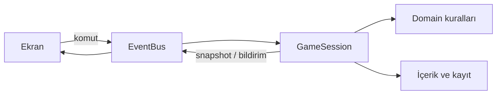

# CoFFallen

Godot ile yapılmış, hikâye ve Endless modları olan oynanabilir kahve oyunu prototipi. Çizimler geçici yer tutucudur. Godot 4.7.2 ile doğrulandı.

## Çalıştırma

Godot'ta `project.godot` dosyasını aç ve **F5**'e bas. Ana ekrandan Hikâye veya Endless seç. Terminalden: `godot --path .`

İlk gece: normal bir içecek servis et → **B** ile defteri aç → sağdaki **???** ayracına tıkla → defteri kapat → parlayan kepenk düğmesine bas. İkinci gün fotoğraf/GBT açılır. Oyun kararları otomatik kaydeder.

| İşlem | Tuş |
| --- | --- |
| Diyalog / sonraki ziyaret | Boşluk |
| Malzeme seç | 1–6 |
| Demle / servis et / sıfırla | E / F / R |
| Tarif kitabı / raf kepengi | B / M |
| Fotoğraf / GBT terminali | C / G |
| Menü / pencereyi kapat | Esc |

## Nerede ne var?

| Klasör | Sorumluluk |
| --- | --- |
| `content/` | Karakterler, konuşmalar, günler, ürünler, rastgele havuzlar ve sonlar. JSON düzenleyerek içerik ekle. |
| `content/i18n/tr.json` | Düğmeler, yardım, sistem mesajları ve bütün sabit arayüz metinleri. |
| `domain/brewing/` | Üç malzemeden tarif bulma ve stok uygunluğu. |
| `domain/encounters/` | İnsan/Fallen kutusu, görünüş seçimi, ürün kutusu ve ortak vardiya üreticisi. |
| `domain/consequences/` | Sonların açılma kuralları. |
| `domain/shift/` | Kaydedilebilir oyun durumu. |
| `application/` | EventBus ve komutları çalıştıran oyun oturumu. Durumu yalnızca oturum değiştirir. |
| `infrastructure/` | JSON okuma/doğrulama, i18n ve otomatik kayıt. |
| `presentation/` | Ekranlar, tarif kitabı, GBT, yer tutucu çizimler. |
| `tests/` | Oyun kuralları, vardiya üretimi, hikâye/Endless akışları ve ekran kontrolü. |



Domain, sahnelere ve EventBus'a bağımlı değildir. Ekranlar birbirini çağırmaz; snapshot okur ve komut yayınlar. EventBus oyun durumu tutmaz. Uygulama katmanı domain kurallarını çalıştırıp sonucu yayınlar.

İçerik ve havuz örnekleri: [İçerik ekleme rehberi](docs/ICERIK_EKLEME.md). Çizimleri değiştirme: [Görsel rehberi](assets/README.md).

## Şimdiki kapsam

Dört günlük örnek hikâye, yedi tarif, iki tedarikçi, hikâye karakterleri ve rastgele müşteri havuzları bulunur. Hikâyede sabit ziyaretler arasına gece müşterileri eklenir. Endless ilk gün öğreticisini korur; devamında her gün yeni ziyaretler üretir ve dördüncü günde bitmez. Tedarikçilerin yakalama koşulları Endless'ta da geçerlidir.

Dört son aktiftir: Defne'nin yakalaması, Vey'in yakalaması, Fallen hâkimiyeti ve gri son. Beşinci son kullanıcı kararıyla **ayrılmış, henüz yazılmamış** bir yuvadır. Yanlış servisler/ihbarlar aynı sonun alt metnini değiştirebilir. Gri sonun ilk kuralı: en az iki doğru kayıt, iki tarafa %40–60 dağılım ve en fazla bir hata. Bu eşikler `content/endings.json` içindedir; henüz oynayarak dengelenmedi.

## Kontroller

```bash
godot --headless --path . --editor --import --quit
godot --headless --path . --script tests/domain_test.gd
godot --headless --path . --script tests/encounter_test.gd
godot --headless --path . --script tests/flow_test.gd
godot --headless --path . --script tests/localization_test.gd
godot --path . --script tests/visual_smoke.gd
```

Akış testleri kullanıcının kaydına yazmaz. Son komut gerçek pencere açar ve ekran görüntülerini `/tmp/coffallen-*.png` olarak kaydeder. Otomatik oyun kaydı Godot'un `user://coffallen_v1.json` dosyasındadır; rastgele üretilen ziyaretler de kayda dahildir.
