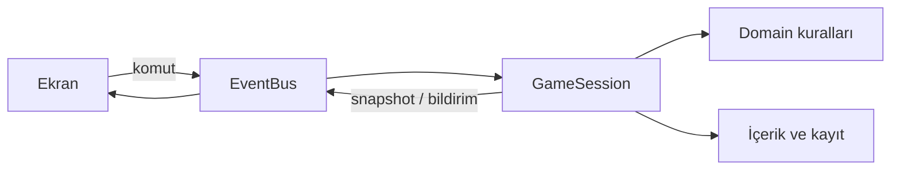

# CoFFallen

CoFFallen, gündüz insanlara, gece insanlara ve Fallen'lara hizmet verdiğimiz bir kahve oyunu. Bu depo oyunun çalışma klasörüdür. Şu an oynanabilir prototip aşamasındadır; çizimler geçici yer tutucudur.

## İlk kez açıyorsan: üç şeyi bilmen yeterli

**Godot oyunu çalıştıran programdır.** **JSON dosyaları oyunun yazılı defterleridir:** konuşmalar, karakterler, tarifler ve düğme yazıları burada durur. **Görseller `assets/` klasörüne konur.** Bir konuşmayı veya tarifi değiştirmek için programlama bilmen gerekmez.

| Yapmak istediğin | Açacağın dosya |
| --- | --- |
| Oyunu Godot'a eklemek | Ana klasördeki `project.godot` |
| Bir karakterin adını, görünüş bilgisini veya sicilini değiştirmek | `content/characters.json` |
| Belli gün gelecek karakteri ve konuşmasını düzenlemek | `content/days.json` |
| Yeni içecek veya tarif eklemek | `content/recipes.json` |
| Düğme, yardım veya bildirim yazısını değiştirmek | `content/i18n/tr.json` |
| Rastgele müşteri sayısını ve insan/Fallen ihtimalini değiştirmek | `content/encounter_pools.json` |
| Sonların metnini ve denge eşiklerini değiştirmek | `content/endings.json` |
| Kendi çizimlerini eklemek | `assets/` ve [görsel ekleme rehberi](assets/README.md) |

JSON'da **`id` kaydın sabit kimliğidir**, **`name` ekranda görünen adıdır**. Örneğin `latte` kimliğini değiştirmeden görünen içecek adını değiştirebilirsin. Dosyayı kaydet, oyunu yeniden başlat ve yeni içeriği denemek için yeni hikâye aç. Ayrıntılı örnekler: [İçerik ekleme rehberi](docs/ICERIK_EKLEME.md).

## Godot'a ekleme: oyun proje listesinde görünmüyorsa

Projeyi bilgisayara indirmek veya GitHub'dan çekmek, Godot'un proje listesine kendiliğinden eklemez. **Bir kez içe aktarmak gerekir.** Bu proje Godot **4.7.2** ile kontrol edildi.

1. Godot'u aç; **Proje Yöneticisi / Project Manager** ekranına gel.
2. **İçe Aktar / Import** düğmesine bas.
3. İndirdiğin `Junior-Jam` klasörünün içindeki **`project.godot`** dosyasını seç. ZIP indirdiysen önce ZIP'i bir klasöre çıkar.
4. **İçe Aktar ve Düzenle / Import & Edit** seçeneğiyle aç. Godot ilk açılışta dosyaları hazırlarken bekle.
5. Listede oyunun adı **CoFFallen** olarak görünür; klasör adı `Junior-Jam` olarak kalabilir. Sonraki açılışlarda CoFFallen'a çift tıklaman yeterlidir.
6. Editörde sağ üstteki **▶ Çalıştır** düğmesine bas. Klavye karşılığı **F5**'tir. Açılan oyun ekranında **Hikâye modu** veya **Endless** seç.

Bu bilgisayarda içe aktarılacak dosyanın tam yolu:

```text
/home/kaanalper/Junior-Jam/project.godot
```

Godot açıkken listeye kayıt eklenmişse Proje Yöneticisi'ni kapatıp yeniden aç. Hâlâ görünmüyorsa arama kutusunu ve etiket filtrelerini temizle, ardından yukarıdaki dosyayı içe aktar.

### Sahneyi oyunu başlatmadan 2B sekmesinde görmek

1. Soldaki **Dosya Sistemi / FileSystem** bölümünden `presentation/cafe.tscn` dosyasına çift tıkla.
2. Üstten **2B / 2D** sekmesine geç. Kafe ve arayüz, oyun çalışmadan da görünür.
3. Soldaki Sahne ağacından **CoFFallen** kökünü seç. Gerekirse fare 2B alanındayken **F** ile seçimi ekrana sığdır veya yakınlaşmayı azalt.
4. Sağdaki **Inspector → Editor Preview** alanından görmek istediğin ekranı seç:

| Seçenek | Gösterdiği |
| --- | --- |
| `day` / `night` | Gündüz / gece kafe ve servis arayüzü |
| `book_human` / `book_fallen` | Normal / Fallen tarif kitabı |
| `dossier` | Örnek fotoğraflı dava dosyası |
| `intro` | Başlangıç menüsü |
| `fall` / `ending` | The Fall geçişi / örnek son |

**Editor Character** alanına `ada`, `eren` veya `mira` gibi bir karakter kimliği yazarak çizimini görebilirsin. JSON'u değiştirdikten sonra **Refresh Preview** kutusuna tıkla. Bu seçenekler editör içindir; oyunun başlangıç durumunu değiştirmez. Güncellemeden sonra sahne hâlâ boşsa sahne sekmesini kapatıp tekrar aç; gerekirse Godot'u yeniden başlat.

Önizleme gerçek arayüz çizimini ve aynı JSON metinlerini kullanır. Editörde kayıt oluşturmaz, oyun oturumu başlatmaz ve ortam sesi çalmaz. Arayüz düğmeleri kodla oluşturulur; yerleşimi sürükleyerek değiştirmek için sahnede kalıcı düğümlere dönüştürme ayrıca gerekir. Oynanışı denemek için ▶ / F5 kullan.

Godot'un kendi anlatımı: [mevcut projeyi içe aktarma](https://docs.godotengine.org/en/stable/tutorials/editor/project_manager.html#opening-and-importing-projects).

## Çalıştırma

Oyun **fareyle işaretleyip tıklayarak** oynanır. Konuşma ilerletme, malzeme seçimi, demleme, servis, kitap, ayraç, kepenk, fotoğraf ve dosya tesliminin hepsinin ekranda düğmesi vardır. Klavye kısayolları ek kolaylıktır.

İlk gece: normal bir içecek servis et → **Eski deftere bak** düğmesine tıkla → sağdaki **???** ayracına tıkla → defteri kapat → parlayan kepenk düğmesine tıkla. İkinci gün fotoğraf makinesiyle çek, dava dosyasını açılır. Oyun kararları otomatik kaydeder.

Terminal kullanıyorsan proje klasöründen `godot --path .` oyunu, `godot --editor --path .` editörü açar.

| İşlem | Tuş |
| --- | --- |
| Diyalog / sonraki ziyaret | Boşluk |
| Malzeme seç | 1–6 |
| Demle / servis et / sıfırla | E / F / R |
| Tarif kitabı / raf kepengi | B / M |
| Fotoğraf çek / Dava dosyaları | C / G |
| Menü / pencereyi kapat | Esc |

## Mimariyi basitçe anlamak

Bir müşteri geldiğini düşün: **`content` kimin ne söyleyeceğini anlatır; `domain` hangi fincanın doğru olduğunu bilir; `application` sıradaki işi yürütür; `presentation` gördüğün ekranı çizer; `infrastructure` dosyaları okur ve kaydeder.** Bu görevler ayrı tutulduğu için yeni çizim veya konuşma eklerken kahve kurallarını değiştirmek gerekmez.

**EventBus bir haber panosu gibi çalışır.** Örneğin Servis Et'e tıklayınca ekran panoya “servis istendi” mesajı bırakır. Oyun oturumu kuralları kontrol eder, sonucu yine panoya bırakır; ekran sonucu gösterir. Ekranlar birbirinin içini değiştirmez. **DDD**, bu projede kahve hazırlama, müşteri üretme ve karar sonuçları gibi oyun kurallarını kendi bölümlerinde tutmamızın adıdır.

Bir gece hazırlanırken ortak üretici önce o gece mutlaka gelmesi gereken hikâye karakterlerini yerleştirir. Sonra rastgele müşteriler için insan/Fallen, karakter, görünüş ve ürün havuzlarından seçim yapar. Hikâye ve Endless aynı üreticiyi kullanır. Böylece yeni bir müşteri için ayrı bir oyun akışı yazmak gerekmez.

### Teknik dosya haritası

| Klasör | Sorumluluk |
| --- | --- |
| `content/` | Karakterler, konuşmalar, günler, ürünler, rastgele havuzlar ve sonlar. JSON düzenleyerek içerik ekle. |
| `content/i18n/tr.json` | Düğmeler, yardım, sistem mesajları ve bütün sabit arayüz metinleri. |
| `domain/brewing/` | Üç malzemeden tarif bulma ve stok uygunluğu. |
| `domain/encounters/` | İnsan/Fallen kutusu, görünüş seçimi, ürün kutusu ve ortak vardiya üreticisi. |
| `domain/consequences/` | Sonların açılma kuralları. |
| `domain/shift/` | Kaydedilebilir oyun durumu. |
| `application/` | EventBus ve komutları çalıştıran oyun oturumu. Durumu yalnızca oturum değiştirir. |
| `infrastructure/` | JSON okuma/doğrulama, i18n ve otomatik kayıt. |
| `presentation/` | Ekranlar, tarif defteri, dava dosyası, yer tutucu çizimler. |
| `tests/` | Oyun kuralları, vardiya üretimi, hikâye/Endless akışları ve ekran kontrolü. |



Domain, sahnelere ve EventBus'a bağımlı değildir. Ekranlar birbirini çağırmaz; snapshot okur ve komut yayınlar. EventBus oyun durumu tutmaz. Uygulama katmanı domain kurallarını çalıştırıp sonucu yayınlar.

İçerik ve havuz örnekleri: [İçerik ekleme rehberi](docs/ICERIK_EKLEME.md). Çizimleri değiştirme: [Görsel rehberi](assets/README.md).

## Şimdiki kapsam

Dört günlük örnek hikâye, yedi tarif, iki tedarikçi, hikâye karakterleri ve rastgele müşteri havuzları bulunur. Hikâyede sabit ziyaretler arasına gece müşterileri eklenir. Endless ilk gün öğreticisini korur; devamında her gün yeni ziyaretler üretir ve dördüncü günde bitmez. Tedarikçilerin yakalama koşulları Endless'ta da geçerlidir.

Dört son aktiftir: Defne'nin yakalaması, Vey'in yakalaması, Fallen hâkimiyeti ve gri son. Beşinci son kullanıcı kararıyla **ayrılmış, henüz yazılmamış** bir yuvadır. Yanlış servisler/ihbarlar aynı sonun alt metnini değiştirebilir. Gri sonun ilk kuralı: en az iki doğru kayıt, iki tarafa %40–60 dağılım ve en fazla bir hata. Bu eşikler `content/endings.json` içindedir; henüz oynayarak dengelenmedi.

## Kontroller

```bash
godot --headless --path . --editor --import --quit
godot --headless --path . --script tests/domain_test.gd
godot --headless --path . --script tests/encounter_test.gd
godot --headless --path . --script tests/flow_test.gd
godot --headless --path . --script tests/localization_test.gd
godot --path . --script tests/visual_smoke.gd
```

Akış testleri kullanıcının kaydına yazmaz. Son komut gerçek pencere açar ve ekran görüntülerini `/tmp/coffallen-*.png` olarak kaydeder. Otomatik oyun kaydı Godot'un `user://coffallen_v1.json` dosyasındadır; rastgele üretilen ziyaretler de kayda dahildir.
